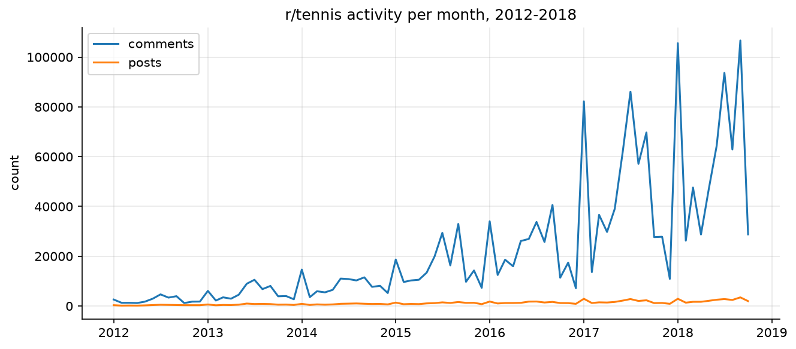
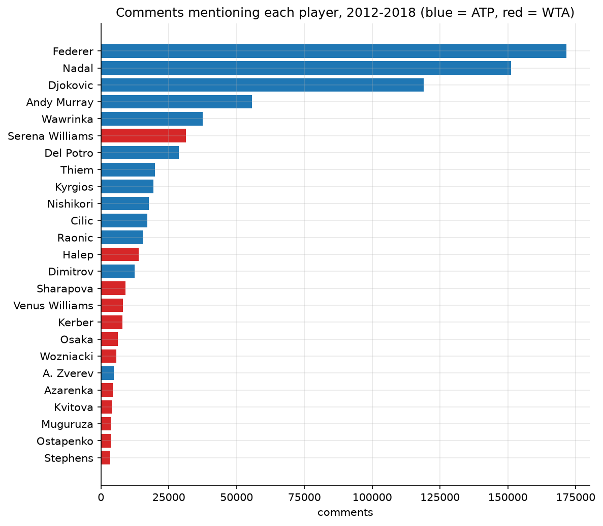
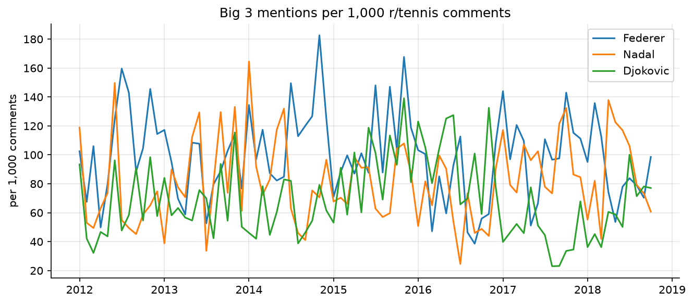
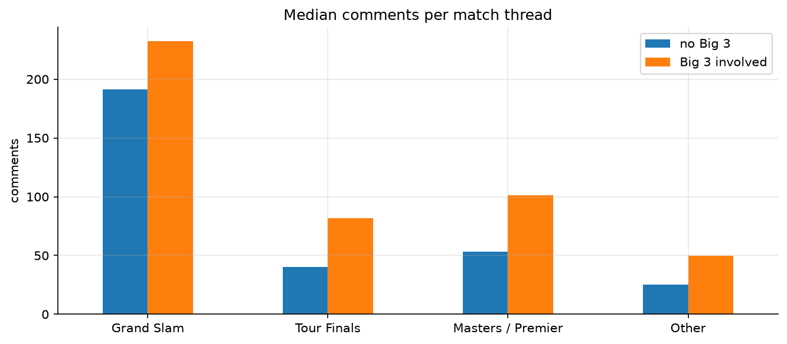

```{python}
import json

import pandas as pd
from IPython.display import HTML


def show(t):
    """Render a table as HTML with thousands separators (no extra packages needed)."""
    t = t.copy()
    for c in t.columns:
        if c == "Year":
            continue
        if pd.api.types.is_integer_dtype(t[c]):
            t[c] = t[c].map("{:,}".format)
        elif pd.api.types.is_float_dtype(t[c]):
            t[c] = t[c].map(lambda x: f"{x:,.1f}".removesuffix(".0"))
    return HTML(t.to_html(index=False, classes="table table-sm", border=0))

D = "data/eda/"
summary = json.load(open(D + "eda_summary.json"))
by_year = pd.read_csv(D + "volume_by_year.csv")
players = pd.read_csv(D + "mentions_by_player.csv")
types = pd.read_csv(D + "thread_types.csv").set_index("thread_type")
link = pd.read_csv(D + "link_rate.csv")
top_days = pd.read_csv(D + "top_days.csv")

total = int(by_year.posts.sum() + by_year.comments.sum())
share_1718 = (by_year.query("year >= 2017")[["posts", "comments"]].sum().sum()) / total
growth = by_year.set_index("year").comments
pct = lambda x: f"{x:.1%}"
num = lambda x: f"{int(x):,}"
link_overall = link.groupby("thread_type")[["threads", "linked"]].sum()
link_overall["rate"] = link_overall.linked / link_overall.threads
```

All counts cover **2012–2018** and are computed in Spark on the full corpus
(code: [`code/eda/04_eda.ipynb`](https://github.com/Laurent2503/tennis-reddit-analysis/blob/main/code/eda/04_eda.ipynb)).

## 1. How much discussion is there?

r/tennis has `{python} num(total)` posts and comments in the analysis window.
Activity grows every year: there were `{python} f"{growth[2018] / growth[2012]:.0f}"` times more
comments in 2018 than in 2012, and 2017–2018 alone account for `{python} pct(share_1718)` of all
discussion. Because of this growth, the player analysis below uses **shares of comments** rather than
raw counts, so a rising trend reflects fan interest and not a bigger subreddit.

```{python}
#| label: tbl-volume
#| tbl-cap: "Posts, comments and active authors per year."
t = by_year.copy()
t["share_deleted"] = (t.share_deleted * 100).round(1).astype(str) + "%"
t.columns = ["Year", "Posts", "Comments", "Authors", "Deleted / removed"]
show(t)
```

{#fig-volume}

About `{python} pct(summary["share_deleted"])` of posts and comments were deleted or removed;
they are excluded from the text analysis.

### The busiest days are the biggest matches

The ten days with the most comments all fall during Grand Slams. The top two are the
2018 Wimbledon semi-final day (Anderson–Isner and Djokovic–Nadal, both over five hours) and the
2017 Australian Open final between Federer and Nadal. The 2018 US Open finals weekend
(Osaka–Williams on September 8, Djokovic–Del Potro on September 9) is also near the top.
Dates are in UTC, so evening matches in the Americas can show up on the next day.

```{python}
#| label: tbl-top-days
#| tbl-cap: "The ten days with the most comments."
t = top_days.head(10).copy()
t.columns = ["Date (UTC)", "Comments"]
show(t)
```

## 2. Who do fans talk about?

Player mentions are found with a dictionary of names and nicknames
([`code/common/players.py`](https://github.com/Laurent2503/tennis-reddit-analysis/blob/main/code/common/players.py)),
matched as whole words without case or accents ("Fed" and "Rafa" count; "fed up" does not).
`{python} pct(summary["share_comments_mentioning_a_player"])` of comments mention at least one of the
`{python} len(players)` listed players.

{#fig-mentions}

**Coverage bias.** `{python} pct(summary["mention_share_by_tour"]["ATP"])` of player mentions are of
men's (ATP) players and only `{python} pct(summary["mention_share_by_tour"]["WTA"])` of women's (WTA)
players. Serena Williams is the only woman in the top ten. The dictionary lists more men than women,
which explains part of the gap, but even the most-discussed women are far behind the Big 3. This is
reported as a finding and kept in mind when comparing ATP and WTA results.

### The Big 3 over time

Federer, Nadal and Djokovic dominate the conversation. Their monthly share of comments moves with
their results: for example, Djokovic's share falls through his 2017 elbow injury and rises again
in mid-2018, when he returned to win Wimbledon. Milestone 2 adds sentiment to these mention counts.

{#fig-big3}

## 3. Linking discussion threads to real matches

r/tennis posts a dedicated **Match Thread** for big matches, and sometimes a **Post-Match Thread**.
Match threads only exist for hyped matches, so **result posts** are linked as well: any other title
that reads like a match or result ("vs", "v", "def", "beats", or a score such as "6-4").
Threads are linked to the official match record (Jeff Sackmann's ATP and WTA data) when:

- both players' surnames appear in the title (nicknames and accents are normalised first), and
- the thread was posted between 1 day before and 16 days after the tournament's start date.

The match data only records each tournament's start date, not the day of each match, so the
proposal's one-day window was replaced by this tournament window.

```{python}
#| label: tbl-types
#| tbl-cap: "Thread types, median comments, and share linked to a match."
t = types.join(link_overall[["linked", "rate"]]).reindex([x for x in ["match", "post-match", "result", "other"] if x in types.index])
t = t.reset_index()[["thread_type", "threads", "median_comments", "linked", "rate"]]
t["rate"] = t.rate.map(lambda x: "" if pd.isna(x) else f"{x:.0%}")
t["linked"] = t.linked.map(lambda x: "" if pd.isna(x) else f"{int(x):,}")
t.columns = ["Thread type", "Threads", "Median comments", "Linked", "Link rate"]
show(t)
```

```{python}
#| output: asis
text = (
    f"{pct(link_overall.loc['match', 'rate'])} of match threads link to a match, so the fallback in the "
    f"proposal (linking by player and date only) is not needed. But there are only "
    f"{num(types.loc['match', 'threads'])} match threads, against {num(types.loc['other', 'threads'])} other threads. "
)
if "result" in link_overall.index:
    text += (
        f"Result posts add {num(link_overall.loc['result', 'linked'])} linked threads. Most result-like titles "
        f"do not name two players from the same tournament, so their link rate is low by design. "
        f"A random sample of 100 linked result posts is checked by hand for link precision."
    )
else:
    text += "Many matches are discussed in result posts instead; these are linked in the next run."
print(text)
```

### First look: what gets attention?

These are medians over linked match threads, before any modelling.

{#fig-attention}

```{python}
#| label: tbl-attention
#| tbl-cap: "Comments per linked match thread."
rows = []
for by, label in [("level", "Event level"), ("big3", "Big 3 involved"), ("upset", "Upset (lower-ranked player won)"), ("tour", "Tour")]:
    a = pd.read_csv(D + f"attention_by_{by}.csv")
    for _, r in a.iterrows():
        group = {True: "Yes", False: "No"}.get(r[by], r[by])
        rows.append([label, str(group), int(r.threads), r["median"], round(r["mean"])])
t = pd.DataFrame(rows, columns=["Feature", "Group", "Threads", "Median comments", "Mean comments"])
show(t)
```

Three early patterns, to be tested in the milestone 2 regression:

- **The event matters most.** Grand Slam match threads get far more comments than Masters/Premier
  or smaller events.
- **The Big 3 add attention at every level.** At each event level, threads with Federer, Nadal or
  Djokovic have a higher median than threads without them.
- **Upsets draw more discussion.** Threads where the lower-ranked player won have a higher median.
  This could partly reflect which matches get a thread at all, so it needs controls.

## Next steps (milestone 2)

1. Model attention per match (all linked threads combined), not only per match thread.
2. Score sentiment for each player mention with VADER plus a tennis-slang lexicon.
3. Fit a Spark MLlib regression of thread comment volume on match features.
